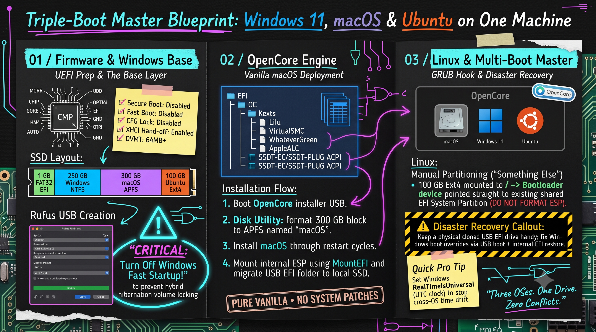
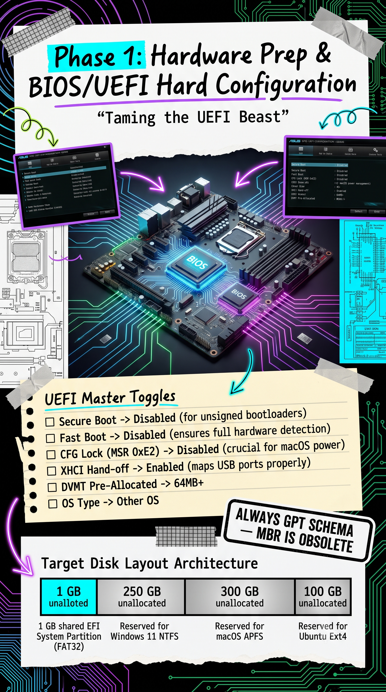
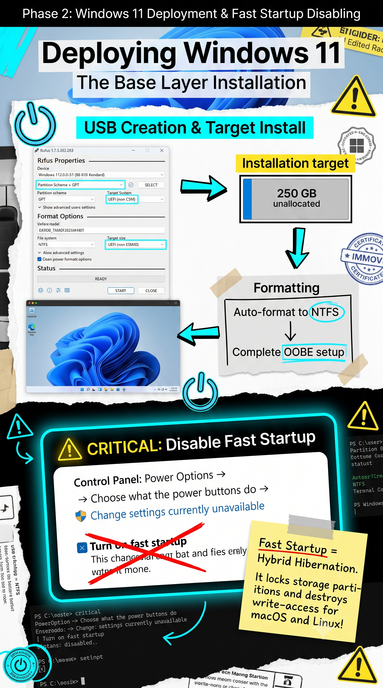
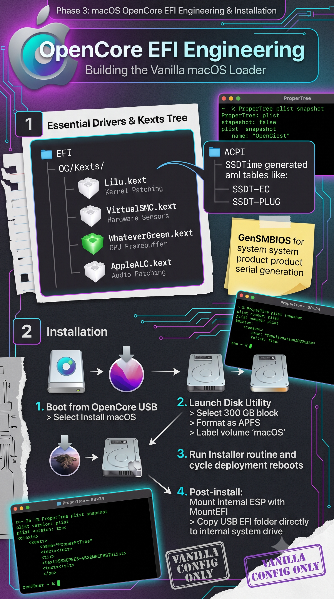
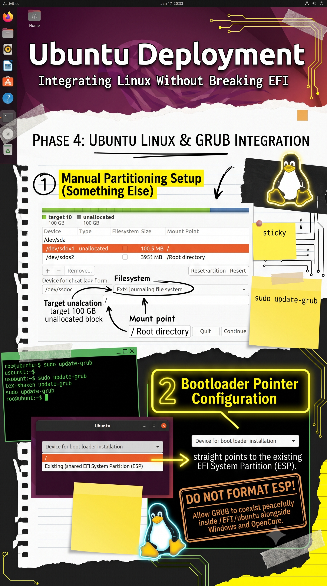

# 🖥️ Enterprise-Grade Triple-Boot Architecture: Windows 11, macOS & Ubuntu Linux

**A Definitive, Step-by-Step Engineering Blueprint for Multi-OS Deployment on a Single UEFI/GPT Drive**

---

## 📋 Executive Summary

Modern workflows often demand specialized environments: **Windows 11** for DirectX gaming and enterprise software, **macOS** for Unix-based creative suites and Apple ecosystem integration, and **Ubuntu Linux** for cloud-native development, Docker containers, and server administration.

Rather than relying on resource-heavy virtual machines or carrying multiple devices, this guide provides a battle-tested, **native bare-metal triple-boot architecture**. By utilizing a single **GUID Partition Table (GPT)** drive and chainloading through the **OpenCore Boot Manager**, all three operating systems coexist peacefully on one machine—complete with a **shared cross-OS data vault**—with zero bootloader conflicts and near-zero performance overhead.



> [!CAUTION]
> **MANDATORY PRE-DEPLOYMENT PROTOCOL: FULL DATA BACKUP**
> Disk partitioning and bootloader engineering modify low-level storage tables. A single misclick can permanently erase existing partitions. **Back up all critical personal files, SSH keys, and project directories to an external drive or cloud storage before initiating Phase 1.**

---

## 🛠️ Prerequisites, OS Images & Toolchain

### 1. Hardware Requirements
* **Host System:** Intel (6th Gen Skylake through 10th Gen Comet Lake natively; 11th+ Gen requires spoofing/iGPU caveats) or supported AMD Ryzen laptop with UEFI firmware.
* **System Memory (RAM):** Minimum **8 GB** (16 GB+ recommended for smooth operation across modern OS releases).
* **Internal Storage:** Minimum **512 GB NVMe/SATA SSD** (1 TB+ SSD strongly recommended to comfortably accommodate three OS volumes plus a shared data partition).
* **Installation Media:** Three **USB 3.0+ Flash Drives** (16 GB minimum capacity each—or two drives if you reuse one after installing Windows). *All existing data on these USB drives will be erased.*

### 2. Required Operating System Images (ISOs / Installers)
Download and stage all three official OS installation images before starting:

| Operating System | Required Image / Installer | Official Acquisition Method |
| :--- | :--- | :--- |
| **Windows 11** | `Win11_x64.iso` (Official 64-bit ISO) | [Microsoft Windows 11 Download](https://www.microsoft.com/software-download/windows11) |
| **macOS** | Vanilla macOS Recovery / Full Installer (`macOS Sonoma` / `Sequoia` / `Ventura`) | Downloaded via Apple App Store on a Mac or fetched directly via OpenCore's `macrecovery.py` utility |
| **Ubuntu Linux** | `ubuntu-24.04-desktop-amd64.iso` (Latest LTS Release) | [Ubuntu Desktop Releases](https://ubuntu.com/download/desktop) |

### 3. Essential Software Toolchain
Download and organize the following utilities on your host Windows machine:

| Utility | Purpose | Official Source |
| :--- | :--- | :--- |
| **Rufus (v4.x+)** | Creates GPT/UEFI-compliant bootable USB media for Windows 11 and Ubuntu. | [rufus.ie](https://rufus.ie/) |
| **MiniTool Partition Wizard** | Non-destructive partition resizing, EFI expansion, and shared data volume formatting. | [partitionwizard.com](https://www.partitionwizard.com/) |
| **OpenCorePkg (Release)** | Core UEFI bootloader enabling vanilla macOS execution on PC hardware. | [GitHub Releases](https://github.com/acidanthera/OpenCorePkg/releases) |
| **ProperTree** | Cross-platform plist editor for structuring OpenCore's `config.plist`. | [GitHub Repo](https://github.com/corpnewt/ProperTree) |
| **GenSMBIOS & SSDTTime** | Generates compliant Apple hardware identifiers and custom ACPI tables. | [CorpNewt GitHub](https://github.com/corpnewt) |
| **MountEFI / OCAT** | Mounts hidden FAT32 EFI partitions safely inside macOS and Windows. | [GitHub Repo](https://github.com/ic005k/OCAuxiliaryTools) |

---

## 🗺️ Deployment Roadmap

1. [Phase 1: UEFI Firmware Hardening & Storage Architecture](#phase-1-uefi-firmware-hardening--storage-architecture)
2. [Phase 2: Windows 11 Base Layer Deployment & Power State Hygiene](#phase-2-windows-11-base-layer-deployment--power-state-hygiene)
3. [Phase 3: macOS OpenCore EFI Engineering & Installation](#phase-3-macos-opencore-efi-engineering--installation)
4. [Phase 4: Ubuntu Linux Deployment & Non-Destructive GRUB Integration](#phase-4-ubuntu-linux-deployment--non-destructive-grub-integration)
5. [Phase 5: Unified Boot Orchestration, Clock Sync & Disaster Recovery](#phase-5-unified-boot-orchestration-clock-sync--disaster-recovery)

---

## Phase 1: UEFI Firmware Hardening & Storage Architecture



### 1.1 UEFI Firmware Configuration
Consumer laptops ship with firmware locks designed exclusively for Windows. To allow OpenCore and Linux kernels to initialize hardware directly, adjust your UEFI parameters:

1. **Perform a Cold Shutdown:** Hold `Shift` while clicking **Shut Down** in Windows to bypass hybrid sleep states.
2. **Enter Firmware Setup:** Power on the laptop and immediately tap your OEM firmware key (`F2` for ASUS/Dell/Acer, `F10` for HP, `F1`/`Enter` for Lenovo, or `Del`).
3. **Switch to Advanced Mode:** Press `F7` (or select *Advanced Mode*) to expose full chipset parameters.
4. **Apply the Master Firmware Matrix:** *(Note: Firmware menus vary by vendor; configure every option present on your board and safely skip any that are hidden).*

| Firmware Parameter | Target State | Architectural Rationale |
| :--- | :--- | :--- |
| **Secure Boot** | `Disabled` | Permits execution of unsigned third-party bootloaders (OpenCore & custom kernels). |
| **Fast Boot** | `Disabled` | Forces full USB controller and storage bus enumeration during POST. |
| **CFG Lock (MSR 0xE2)** | `Disabled` | Unlocks CPU power management registers so macOS XCPM does not kernel panic. |
| **XHCI Hand-off** | `Enabled` | Transfers USB 3.0 controller ownership cleanly from BIOS to the OS kernel. |
| **DVMT Pre-Allocated** | `64 MB` (or higher) | Allocates sufficient video frame buffer memory to prevent macOS display panics. |
| **SATA / Storage Mode** | `AHCI` | Mandatory; macOS and Linux cannot detect drives set to Intel RST / RAID mode. |
| **OS Type** | `Other OS` | Disables Windows-exclusive UEFI signature enforcement hooks. |

5. Press `F10` to **Save Changes & Reset**.

### 1.2 Storage Allocation Strategy (Recommended Baseline vs. Dynamic Ratios)
To prevent duplicate files across three operating systems, this architecture reserves a **Shared Data Partition (`exFAT`)** alongside the three OS blocks. Because `exFAT` is natively readable and writable by **Windows 11, macOS, and Ubuntu Linux**, it serves as a universal vault for projects, media, and downloads.

#### Option A: Recommended Baseline Allocation (1 TB / ~931 GiB Usable Drive — Best Practice)
For a standard 1 TB SSD, allocate the three OS blocks using the recommended baseline sizes below and dedicate the remaining space to your common data partition:

| Partition Block | Recommended Size | Target File System | Role & Workload Allocation |
| :--- | :--- | :--- | :--- |
| **EFI System Partition (ESP)** | **1 GB (1024 MB)** *(Min 512 MB)* | `FAT32` | Shared boot hub housing Windows Boot Manager, OpenCore (`OC`), and Ubuntu (`GRUB`). |
| **Windows 11 Volume** | **250 GB** *(Recommended)* | `NTFS` | Windows OS, DirectX games, and Windows-only productivity suites. |
| **macOS Volume** | **300 GB** *(Recommended)* | `APFS` | macOS system container, Xcode, creative media tools, and system caches. |
| **Ubuntu Linux Volume** | **100 GB** *(Recommended)* | `Ext4` | Root (`/`) filesystem, Docker containers, compilers, and Linux repositories. |
| **Common Data Vault** | **~280 GB (Remaining Space)** | `exFAT` | Shared storage drive natively accessible for read/write across all three OSes. |

#### Option B: Flexible Percentage Ratio (For 512 GB, 2 TB, or Custom Drives)
For smaller or larger SSDs, calculate your usable drive capacity (after reserving **1 GB** for the shared EFI partition) using a balanced **25% : 30% : 15% : 30%** ratio:

$$\text{Windows 11 (25\%)} \quad : \quad \text{macOS (30\%)} \quad : \quad \text{Ubuntu Linux (15\%)} \quad : \quad \text{Common Data (30\%)}$$

* **Example for a 512 GB SSD (~476 GB usable):**
  * **EFI Partition:** `1 GB` (`FAT32`)
  * **Windows 11:** `~120 GB` (`25%`) — *Leave Unallocated*
  * **macOS:** `~145 GB` (`30%`) — *Leave Unallocated*
  * **Ubuntu Linux:** `~70 GB` (`15%`) — *Leave Unallocated*
  * **Common Data Vault:** `~140 GB` (`30%`) — *Format as `exFAT` (Label: `SHARED_DATA`)*

> [!IMPORTANT]
> **Why Resize the EFI Partition to 1 GB?**
> Windows creates a tiny **100 MB** EFI partition by default. Storing **Windows + OpenCore (with themes/resources) + Ubuntu GRUB** inside 100 MB frequently triggers `"Out of Disk Space"` errors during OS updates. Expanding the ESP to **1 GB** eliminates this bottleneck permanently.

### 1.3 Executing the Disk Layout
1. Boot into Windows and launch **MiniTool Partition Wizard** (or DiskGenius).
2. **Verify GPT Schema:** Right-click your primary disk label on the left pane. If the menu displays *"Convert GPT Disk to MBR Disk"*, your drive is already using **GPT**—do **not** convert it. *(MBR disks cannot boot modern UEFI multi-OS setups).*
3. **Expand the ESP:** Shrink the front of your existing Windows partition slightly and expand the **EFI System Partition** to **1024 MB (1 GB)** formatted as `FAT32`.
4. **Carve OS & Shared Blocks:** Right-click your main partition, select **Move/Resize**, and shrink it to create:
   * Three **Unallocated Space** blocks for **Windows 11**, **macOS**, and **Ubuntu Linux** *(leave these completely unformatted so each OS installer formats its block natively)*.
   * One **Common Data Partition** formatted directly as **`exFAT`** with the volume label **`SHARED_DATA`**.
5. Click **Apply** in the top toolbar and allow the partition table to rebuild.

---

## Phase 2: Windows 11 Base Layer Deployment & Power State Hygiene



We deploy Windows first because its installer aggressively writes boot records to the EFI partition. Establishing Windows as the foundation prevents it from overwriting OpenCore later. *(If you already have a healthy Windows 11 installation on your designated block, skip directly to **Section 2.3**).*

### 2.1 Building UEFI Windows Media
1. Connect your first blank USB flash drive and launch **Rufus**.
2. Select your official **Windows 11 ISO** (`Win11_x64.iso`).
3. Verify the target parameters:
   * **Partition scheme:** `GPT`
   * **Target system:** `UEFI (non CSM)`
   * **File system:** `NTFS`
4. Click **START** and wait for media creation to complete.

### 2.2 Clean Installation on Target Block
1. Reboot the laptop and invoke the one-time **UEFI Boot Override Menu** (`F12`, `F8`, `Esc`, or `F9` depending on OEM).
2. Select the **UEFI: [Your USB Drive Name]** entry.
3. Advance to the *"Where do you want to install Windows?"* screen.
4. Highlight your designated **250 GB Unallocated Space** block, click **New** $\rightarrow$ **Apply** (which automatically formats it to `NTFS`), and click **Next**.
5. Complete the Out-of-Box Experience (OOBE) setup until you reach the Windows desktop. Verify that your `SHARED_DATA` (`exFAT`) drive appears cleanly in File Explorer.

### 2.3 Disabling Windows Fast Startup (Mandatory)

> [!WARNING]
> **Preventing Cross-OS Filesystem Corruption**
> By default, Windows **Fast Startup** performs a hybrid hibernation (`hiberfil.sys`) upon shutdown, leaving storage controllers and shared volumes (`SHARED_DATA` / `NTFS`) in a "dirty/locked" state. If macOS or Ubuntu mounts a Fast-Startup-locked `exFAT` partition, **severe cross-OS data corruption will occur**.

1. Open **Control Panel** $\rightarrow$ **Hardware and Sound** $\rightarrow$ **Power Options**.
2. Select **Choose what the power buttons do** from the left navigation pane.
3. Click **Change settings that are currently unavailable** (requires Administrator elevation).
4. **Uncheck** the box labeled **Turn on fast startup (recommended)**.
5. Click **Save changes**.

---

## Phase 3: macOS OpenCore EFI Engineering & Installation



Unlike Windows or Linux, macOS expects specific Apple hardware tables (ACPI) and System Management Controller (SMC) responses. **OpenCore** acts as an in-memory firmware bridge, injecting only the minimal drivers required to boot a pure, unmodified ("vanilla") copy of macOS.

### 3.1 Structuring Your OpenCore EFI Directory
1. Extract the official `OpenCore-RELEASE` archive and copy its `EFI` directory to your workspace.
2. **Stage Essential Kernel Extensions (`EFI/OC/Kexts/`):**
   * `Lilu.kext` — Core arbitrary kext and process patching engine (must load first).
   * `VirtualSMC.kext` — Emulates Apple's SMC chip for battery, thermal, and power management.
   * `WhateverGreen.kext` — Patches Intel/AMD GPU framebuffers, backlight control, and DRM.
   * `AppleALC.kext` — Enables native macOS HD Audio without modifying system files.
   * **Input & Networking:** Add `VoodooPS2Controller.kext` (laptop keyboard/trackpad) and your specific NIC driver (`IntelMausi.kext` for Intel Ethernet, or `itlwm.kext` / `AirportItlwm.kext` for Intel Wi-Fi).
3. **Generate Machine-Specific ACPI Tables (`EFI/OC/ACPI/`):**
   * Run **SSDTTime** on your Windows host to dump your DSDT and generate `SSDT-EC.aml` (Embedded Controller) and `SSDT-PLUG.aml` (CPU Power Management). Place both `.aml` files inside `EFI/OC/ACPI/`.
4. **Configure Hardware Identity (`SMBIOS`):**
   * Launch **GenSMBIOS**, select a Mac model closely matching your laptop's CPU generation (e.g., `MacBookPro15,2` or `MacBookPro16,1`), and generate a unique Serial Number, Board Serial (`MLB`), and `SmUUID`.
5. **Compile & Validate `config.plist`:**
   * Open `EFI/OC/config.plist` in **ProperTree**.
   * Press `Ctrl + R` (**OC Clean Snapshot**) and point it to your `EFI/OC` folder so every kext, driver, and SSDT is indexed in strict load order.
   * Populate your `PlatformInfo -> Generic` fields with the GenSMBIOS output.
   * *(Fallback Tip: If your laptop BIOS lacked a manual **CFG Lock** toggle in Phase 1, set both `AppleCpuPmCfgLock` and `AppleXcpmCfgLock` to `True` under `Kernel -> Quirks`).*
   * Press `Ctrl + S` to save.

### 3.2 Deploying macOS to the APFS Block
1. Prepare your macOS bootable USB installer, mount its hidden `FAT32` EFI partition using **MountEFI** or **MiniTool**, and copy your engineered `EFI` folder into the root of that partition.
2. Reboot the laptop, boot from the USB drive, and select **Install macOS** in the OpenCore boot picker.
3. Once inside macOS Recovery, launch **Disk Utility**.
4. In the top menu bar, click **View** $\rightarrow$ **Show All Devices**.
5. Select your designated **300 GB** unallocated/unformatted partition block, click **Erase**, and configure:
   * **Name:** `macOS`
   * **Format:** `APFS`
   * **Scheme:** `GUID Partition Map` *(if prompted on a full disk view, only erase the target partition, never the parent drive or `SHARED_DATA`!)*
6. Quit Disk Utility, select **Install macOS**, target your newly formatted **`macOS`** volume, and begin installation.
   * *Note: The installer will reboot 3–4 times automatically. Always allow OpenCore to continue booting the **macOS Installer** entry until you reach the Country/Region setup assistant.*

### 3.3 Migrating OpenCore to the Internal SSD
1. Once logged into the macOS desktop, run **MountEFI** (or OpenCore Auxiliary Tools).
2. Mount **both** your USB installer's EFI partition and your internal SSD's **1 GB EFI System Partition**.
3. Copy the verified `EFI` folder from the USB drive and paste it directly into the root of your internal SSD's EFI partition (alongside the existing `EFI/Microsoft` folder).
4. Eject the USB drive—your laptop can now initialize OpenCore natively from internal storage, and `SHARED_DATA` will mount automatically on your macOS desktop.

---

## Phase 4: Ubuntu Linux Deployment & Non-Destructive GRUB Integration



Ubuntu's automated installer defaults to overwriting the primary UEFI boot entry with GRUB. By using **Manual Partitioning**, we confine Ubuntu strictly to its 100 GB block while allowing GRUB to coexist peacefully inside our shared 1 GB EFI partition.

### 4.1 Creating Ubuntu Installation Media
1. Insert a blank USB flash drive and open **Rufus**.
2. Select your **Ubuntu LTS ISO** (`ubuntu-24.04-desktop-amd64.iso`), ensure Partition Scheme is set to **GPT** and Target System is **UEFI**, and click **START**.

### 4.2 Manual Partitioning & Bootloader Targeting
1. Boot your laptop from the Ubuntu USB media and select **Try or Install Ubuntu** $\rightarrow$ **Install Ubuntu**.
2. When prompted for **Installation Type**, **DO NOT** choose *"Install Ubuntu alongside them"* or *"Erase disk"*. Select **Manual Partitioning ("Something else")**.
3. Locate your **100 GB free space** block in the partition table, highlight it, and click **`+`**:
   * **Size:** Full capacity (`~102400 MB`)
   * **Type for the new partition:** `Primary`
   * **Location:** `Beginning of this space`
   * **Use as:** `Ext4 journaling file system`
   * **Mount point:** `/` *(Root filesystem)*
   * *(Optional: You may also assign your `SHARED_DATA` `exFAT` partition to mount automatically at `/media/shared` without formatting it).*

> [!CAUTION]
> **CRITICAL BOOTLOADER POINTER CHECK**
> Before clicking *Install Now*, inspect the dropdown menu at the very bottom labeled **Device for boot loader installation**.
> * Select your **existing 1 GB EFI System Partition (ESP)** (typically `/dev/nvme0n1p1` or `/dev/sda1`, labeled as `efi`).
> * **DO NOT format the EFI partition.** Ubuntu will safely write its boot files into `/EFI/ubuntu` without disturbing `/EFI/OC` (OpenCore) or `/EFI/Microsoft` (Windows).

4. Click **Install Now**, verify the partition summary dialog shows **only** your new `Ext4` partition being formatted, configure your user credentials, and reboot upon completion.

---

## Phase 5: Unified Boot Orchestration, Clock Sync & Disaster Recovery


### 5.1 Establishing OpenCore as the Master Boot Manager
Ubuntu's installation automatically places `ubuntu` (GRUB) at the top of your motherboard's NVRAM boot order. Elevate **OpenCore** back to Position #1 so it serves as your single, clean graphical gateway to all three operating systems:

1. Reboot the laptop and enter **UEFI/BIOS Setup** (`F2` / `Del` / `F12`).
2. Navigate to **Boot** $\rightarrow$ **UEFI Hard Disk Drive BBS Priorities** (or *Boot Option Priorities*).
3. Set **OpenCore** as **Boot Option #1**.
4. Press `F10` to **Save & Exit**.

Upon reboot, **OpenCore** will load automatically, displaying clean icons for **macOS**, **Windows 11**, and **Ubuntu Linux** (detected via `OpenLinuxBoot.efi` or chainloaded cleanly to GRUB).

### 5.2 Resolving Cross-OS Hardware Clock Drift
By default, **macOS and Ubuntu** store time on your motherboard's Real-Time Clock (RTC) in **UTC (Coordinated Universal Time)**, whereas **Windows** expects the hardware clock to reflect **Local Time**. Switching between operating systems will cause Windows to display an incorrect clock offset.

**The Permanent Registry Fix:**
1. Boot into **Windows 11**.
2. Search for **Command Prompt**, right-click it, and choose **Run as administrator**.
3. Execute the following command to instruct Windows to interpret the hardware clock as UTC:
   ```cmd
   reg add "HKEY_LOCAL_MACHINE\System\CurrentControlSet\Control\TimeZoneInformation" /v RealTimeIsUniversal /t REG_DWORD /d 1 /f
   ```
4. Reboot—all three operating systems will now maintain identical, synchronized system time.

### 5.3 Disaster Recovery & Maintenance Protocol

> [!TIP]
> **Golden Rule of Multi-Boot Maintenance:** Never perform major OS upgrades without an external EFI backup on hand.

* **Stage an Emergency Rescue Key:** Format a small spare USB flash drive as `FAT32`, name it `EFI-RESCUE`, and copy your verified internal `EFI` folder onto it. Store this drive safely offline.
* **Recovering from Windows Update Overrides:** Major Windows cumulative updates occasionally rewrite NVRAM boot variables, causing the laptop to boot straight into Windows and hiding OpenCore:
  1. Plug in your **`EFI-RESCUE`** USB drive and press your laptop's one-time boot menu key (`F12` / `F8`).
  2. Boot from the USB drive into OpenCore, then launch **macOS** (or Windows with Explorer++ as Admin).
  3. Mount the internal SSD's `1 GB` EFI partition, restore your `EFI/OC` and `EFI/BOOT` directories if altered, and re-verify **OpenCore** is set to **Boot Option #1** in UEFI setup.

---

## 📁 Repository Structure

To keep documentation visuals separated from categorized configuration files, ACPI tables, and helper scripts, organize the repository using the following structure:

```text
📦 Triple-Boot-Master-Guide
 ┣ 📂 img                    # README Visual Blueprints & Infographics
 ┃ ┣ 🖼️ 3bi.png              # Cover Blueprint Banner (Placed after Executive Summary)
 ┃ ┣ 🖼️ p1.png               # Phase 1: UEFI Firmware & Disk Layout
 ┃ ┣ 🖼️ p2.png               # Phase 2: Windows 11 Deployment & Fast Startup
 ┃ ┣ 🖼️ p3.png               # Phase 3: OpenCore EFI Engineering & macOS
 ┃ ┣ 🖼️ p4.png               # Phase 4: Ubuntu Manual Partitioning & GRUB
 ┃ ┗ 🖼️ p5.png               # Phase 5: Master Boot Menu & Recovery
 ┣ 📂 efi-configs            # Sample OpenCore config.plist templates (Sanitized)
 ┣ 📂 tools                  # Tools and files required
 ┣ 📂 scripts                # Windows UTC clock fix (.reg) & post-install helpers
 ┗ 📄 README.md              # Master Documentation
```